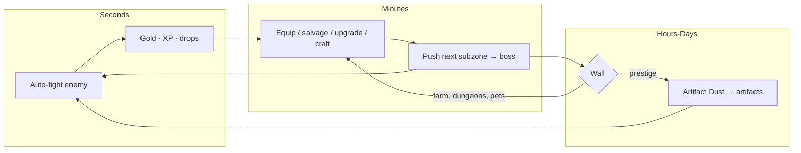

# GDD.md — Game Design Document

> **Status:** v0.2. Design review of 2026-11-19 applied; decisions are in DECISIONS.md. **Working title:** *TBD* (Creative Direction is a later deliverable).
> **Authority:** The Master Studio Prompt plus this GDD once approved. Numbers live in GAME_BALANCE.md.
> **Tags:** each rule is marked **[SPEC]** (from the master prompt), **[APPROVED]** (your decisions), or **[PROPOSED]** (pending your approval; DECISIONS.md lists them).

---

## 1. Vision

A dark fantasy idle RPG for Android: three heroes take turns fighting through an endless, darkening world. Progress comes from loot, builds and permanent prestige power, never from paying.

### 1.1 Pillars
1. **Always progressing.** Something gets stronger every session, online or offline.
2. **Build ownership.** Attribute points, skill trees, elements and gear choices matter. Auto-play never means no decisions.
3. **The wall is a friend.** Walls are readable ("you need 2× damage"), and prestige is the satisfying way through.
4. **Fair and respectful.** Gems buy time and looks, never power. No forced ads. Fully playable offline.
5. **Built to last.** Data-driven content: new regions, families, pets and artifacts come from data, not code changes.

### 1.2 Anti-goals
- Pay-to-win, energy or stamina gates, forced ads.
- Combat that needs manual input to be efficient.
- A final endpoint, or numbers that overflow and break.
- Systems that only exist to slow the player down without a choice attached.

---

## 2. Core loops



| Loop | Length | Player decisions |
|---|---|---|
| Combat | 1–5 s | none (auto) |
| Management | 1–10 min per session | gear, upgrades, stat points, skills, active character, zone, boss toggle |
| Region push | 15 min – 2 h | when to fight the boss, where to farm, which character |
| Dungeon | 3–5 min a run | which dungeon, spend or save tokens |
| Prestige | 1–3 days (early) → longer | when to reset, which artifacts to buy |

---

## 3. Characters

**Purpose:** three play styles with independent growth; only the active character fights.

**Rules**
- [SPEC] Fighter, Archer and Mage are all available from the start. Exactly **one active character**; switching is free and instant outside boss fights.
- [SPEC] Each character has its own level, XP, attributes, skill points, skill trees and equipped items.
- [APPROVED D-024] **Only the active character earns XP.** A character below the highest character's level gets a **+50% XP catch-up bonus** while active.
- [APPROVED D-004] Items and pets are in a **shared inventory**. An item can be equipped on **only one character at a time**. Equipping it elsewhere unequips it from the previous owner, after a confirmation prompt.
- [APPROVED D-025] Item level requirement: `character level ≥ item level − 5`. This stops a level 300 Fighter's gear from carrying a level 1 Mage.
- [SPEC] Class triangle: **Mage > Archer > Fighter > Mage** (§4.3).

| Class | Primary | Role | Combat identity |
|---|---|---|---|
| Fighter | STR | Durable melee | High HP and armour, **Counter** (D-033), cleave and bleed skills, slower attacks |
| Archer | DEX | Fast, precise | High attack speed, crit and accuracy, multi-shot |
| Mage | INT | Burst caster | Elemental damage %, spells with cooldowns, low HP |

**Edge cases:** switching mid-fight is disabled (button greyed out during the current fight). An inactive character keeps its gear, and gear equipped on an inactive character counts as "in use".
**Acceptance:** two characters cannot reference the same item instance. Switching preserves every character's state exactly.

---

## 4. Combat

**Purpose:** deterministic, fully automatic fights that are independent of animation.

### 4.1 Rules
- [SPEC] Combat logic runs in the core simulation. Animations only *display* events. With animations off, the same results come out.
- [APPROVED D-013] **Event-driven resolution:** each combatant schedules its next action at `t + interval`. The engine processes events in time order, which avoids per-frame ticking. Online, events are released to the UI in real time; offline, they are processed instantly.
- [PROPOSED] One enemy at a time. The next enemy spawns 0.6 s after a kill.
- [APPROVED D-018] **HP fully restores between normal fights.** There is no healing economy in v1. Bosses and dungeon bosses are fought at full HP.
- [PROPOSED] **Defeat in a normal fight:** the character retreats one subzone and continues farming, and the "push" resumes automatically after 60 s. No death penalty beyond lost time.

### 4.2 Damage pipeline [PROPOSED, implementation detail]
Each hit is split into **components** (Physical plus any elemental damage from gear or skills). Each component is multiplied separately:

```
component = base
          × (1 + Σ%damage + Σ%element[e] + Σ%vsFamily[f])     (additive within a pool)
          × ElementMatrix[e][enemyElement]                        (§4.4)
          × (1 − EnemyResist[e])                                  (−0.5 … 0.75)
          × ClassTriangle                                         (§4.3)
          × Crit (if crit: CritDamage)
total = Σ components × (1 − DR)   (DR from target armour vs attacker level)
```
Order matters for testing: it is fixed and documented in code (`DamageCalculator`).

### 4.3 Class triangle [APPROVED D-017]
Each enemy has a **combat archetype** that maps it onto the triangle: *Brute* (Fighter-like), *Marksman* (Archer-like), *Caster* (Mage-like). Bosses have one archetype.

| | vs advantaged target | vs disadvantaged target |
|---|---|---|
| Damage dealt | ×1.20 | ×0.85 |
| Damage taken from it | ×0.85 | ×1.20 |

Mage beats Marksmen, Archer beats Brutes, Fighter beats Casters. This makes the **active character choice** a real decision per region.

### 4.4 Elements [SPEC table, APPROVED D-019 / D-035]
Strong = **×1.5**, Weak = **×0.75**, Neutral = ×1.0. Rows are attack elements, columns are the target's element.

| Attack ↓ / Target → | Fire | Nature | Water | Light | Dark | Physical (no element) |
|---|---|---|---|---|---|---|
| Fire | 1 | **1.5** | 0.75 | 1 | 1 | 1 |
| Nature | 0.75 | 1 | **1.5** | 1 | 1 | 1 |
| Water | **1.5** | 0.75 | 1 | 1 | 1 | 1 |
| Light | 1 | 1 | 1 | 0.75 | **1.5** | 1 |
| Dark | 1 | 1 | 1 | **1.5** | 0.75 | 1 |
| Physical | 1 | 1 | 1 | 0.75 | 0.75 | 1 |

> **Confirmed (D-035):** Light and Dark resist their own element and beat each other; Physical is weak against both.

Enemies have exactly one element (or none = Physical). Elemental damage comes only from gear and skills [SPEC].

### 4.5 Accuracy, crit, speed, counter [PROPOSED numbers; Counter APPROVED D-033]
- `HitChance = clamp(0.92 · Acc / (Acc + Eva/4), 0.30, 0.99)`. Accuracy comes from DEX and gear; evasion is an enemy stat that rises in "agile" families (Beasts).
- Crit: chance cap 75%, base damage 150%.
- Attack interval floor 0.4 s, so attack speed can't run away.
- **Counter:** each time the character is hit, a `CounterChance` roll triggers an immediate extra attack at 60% damage. It doesn't reset or delay the attack timer. Counters can crit but cannot trigger further counters.

### 4.6 Boss encounters
- [SPEC] Available after K(r) kills in the region's last subzone (GAME_BALANCE §2).
- [SPEC] Toggle **"Fight boss when available"** (default ON). When OFF, the character farms the last subzone indefinitely.
- [PROPOSED, simulated] **60 s time limit** (enrage). Failure returns the character to farming, with automatic retry every 60 s while the toggle is ON.
- [APPROVED D-006] Bosses can be fought **offline** under the same rules.
- [SPEC] Defeated bosses are **repeatable**. [PROPOSED] Repeat fights need K(r)/2 kills in that region's last subzone; boss loot table only (no repeat unlock rewards).

**Acceptance (combat):** same seed + same state ⇒ identical event log. Toggling animations doesn't change any reward. All multipliers have unit tests at their boundaries.

---

## 5. Attributes & levelling

**Rules**
- [SPEC] Attributes: STR, DEX, INT, VIT, DEF, Critical Chance, Critical Damage, Luck, + [APPROVED D-033] **Counter**. More can be added as data (`AttributeDefinition`, D-032).
- [APPROVED D-014] **75 / 25:** 4 points per level, **3 automatic** by class template (D-034) and **1 manual** (GAME_BALANCE §4.1). An **auto-allocate** button spends unspent manual points according to a preset the player picks (e.g. "Primary", "Balanced", "Tank", custom ratios).
- [APPROVED] Manual points can be respecced for gold (cost scales with level). They reset for free on prestige.
- [PROPOSED] No level cap. XP curve in GAME_BALANCE §4.3.

| Attribute | Effect |
|---|---|
| STR / DEX / INT | +1.5% damage if it is the class primary. DEX also: +0.5% accuracy, +0.2% attack speed. INT also: +1% elemental damage |
| VIT | +2% max HP |
| DEF | +1% armour |
| Crit Chance | +0.2% crit chance |
| Crit Damage | +1% crit damage |
| Luck | Rarity weight bonus `Luck/(Luck+200)` (diminishing), +0.5% gold |
| Counter | +0.4% counter chance (cap 40%) |

**Acceptance:** a level-up grants exactly 3 automatic + 1 manual point. Auto-allocate never exceeds unspent points and respects the preset ratios. Totals over any level range match the closed-form formula.

---

## 6. Equipment

### 6.1 Rules
- [SPEC] Slots: main hand, off-hand, helmet, chest, legs, boots, armguards, gloves, 2 rings, amulet, pet, 6 accessories.
- [PROPOSED] Accessory slots unlock at region bosses 2, 4, 6, 8, 10 and 12 (a drip of new power and decisions).
- [SPEC] Fixed base stats that scale with item level. Each slot has a **pool of item types** (e.g. 3 helmet types with different stat lines; D-026, D-032). [APPROVED D-003] **Rarity also scales base stats** (Common 1.0 → Mythical 2.5).
- [SPEC] Random attributes per rarity: 0/0/1/1/2/3.
- [SPEC] Generic vs class-specific items. [PROPOSED] Class items carry a bonus line (e.g. "+15% Cleave damage — Fighter only") that is inactive on other classes, shown greyed out.
- [APPROVED D-015] **Starter kit:** each class starts every run with a Common level 1 class weapon. Main-hand items have drop weight ×3.

### 6.2 Item model
`ItemInstance { id, definitionId, itemLevel, rarity, upgradeLevel, randomAffixes[], enchant?, locked, equippedBy? }`. Definitions (ScriptableObjects) say which slot, base stat lines and class bonus an item has. The off-hand can be a weapon (35% damage) or a shield (armour + block chance).

### 6.3 Accessories [PROPOSED]
Six utility slots with unique effects, e.g. *Rope* (+5% gold), *Silver Cross* (+20% damage vs Undead), *Clockwork Gear* (+3% attack speed), *Lucky Dice* (+10 Luck). There is no item-level scaling, so accessories are a horizontal, collection-driven layer.

### 6.4 Upgrading — gold, +5% base stats per level, max by rarity (GAME_BALANCE §6.4).
### 6.5 Salvaging — gives materials by rarity + 50% of gold spent on upgrades. A bulk-salvage filter ("all Common/Uncommon not better than equipped") and item locking protect valuables.
### 6.6 Crafting [APPROVED D-026] — spend materials to create an item for **a chosen slot** at the highest unlocked subzone level. **Item type** (from the slot's pool) and **rarity** are both random. This is the tool against bad luck. *Open detail (Q-8):* whether each region restricts the item-type pool.
### 6.7 Enchanting [APPROVED D-027]
Each Rare+ item has **one enchant socket**, separate from its random attributes. Enchanting rolls an enchant from the item's slot table and costs materials + gold. Re-enchanting replaces it. **Each enchant on the same item multiplies its next gold cost by 1.5** (`enchantCount` stored on the item), which makes it the escalating late-game gold sink (finding B-2). Items keep their enchant when upgraded.

**Edge cases:** the inventory is full (200 slots, expandable with gold) → new drops are auto-salvaged by the filter and appear in the report, never silently lost. A locked item cannot be salvaged.
**Acceptance:** item generation is deterministic per seed. Rarity frequency over 1M rolls stays within statistical tolerance (chi-square p > 0.01).

---

## 7. Skill trees

**Rules**
- [SPEC] Per class: **Common branch** (available) + **Offence / Defence / Utility** (unlocked by prestige), with class-adapted skills.
- [SPEC] Skills are passive effects or automatic combat abilities.
- [PROPOSED] **Skill points:** 1 per 5 levels. They reset with levels on prestige; tree *unlocks* are permanent.
- [APPROVED D-028] **Branch unlock:** Branches unlock with an artifact called **Sigil**, bought with Artifact Dust. The first branch for a class costs 15 dust, the second 100, the third 1 000. Unlocks are per class and permanent.
- [PROPOSED] **Active skills:** up to 3 equipped, fired automatically on cooldown (priority order set by the player). Example Fighter Common branch: *Heavy Swing* (active, 250% damage, 8 s cooldown), *Toughness* (passive, +HP%), *Second Wind* (passive, heal 20% when below 30%, once per fight).
- Each branch has about 12 nodes in 4 tiers. A tier needs 5 points spent in the branch.

**Acceptance:** skill effects come only from data (`SkillDefinition` + effect components). Unlocks survive prestige; points don't.

---

## 8. World

### 8.1 Structure
- [SPEC] Regions → **5 subzones** [APPROVED D-016] → region boss. Region N+1 unlocks when boss N is defeated.
- [SPEC] Each subzone has an enemy family, element mix, archetype mix, level and loot table.
- [PROPOSED] Region definitions are data. Region 1–10 are hand-authored for v1. Region 11+ can be **generated from templates** (family × element × biome palette), so content can reach hundreds of zones without new art for each one.

### 8.2 Enemy families [SPEC]
Humanoids, Beasts, Undead, Demons, Elementals, Constructs, Dragons. Data-driven, so new families can be added. Family traits [PROPOSED]: Beasts have evasion, Constructs armour, Undead are Dark, Elementals have an element, Demons have high damage, Dragons high HP, and Humanoids are mixed archetypes.

### 8.3 Kill requirements — `K(r) = min(100, 10 + 5(r−1))` per subzone.
### 8.4 Rare drops — loot tables support probabilities down to 0.01% (doubles; RNG tested, §TESTING).
### 8.5 Regions 1–10 for v1 — themes come from Creative Direction (pending).
### 8.6 Farming old zones [APPROVED D-036]
Old zones keep their value through:
1. **Zone-exclusive loot:** family accessories and scrolls only drop in specific subzones.
2. **Subzone mastery:** 1 000 kills in a subzone permanently gives +1% gold and drop rate (account-wide, survives prestige).

---

## 9. Pets

- [SPEC] Collectible, start at level 1, have rarities, give passive bonuses, are upgraded with dungeon-only items, and get active effects at higher rarity. The collection is shared.
- [APPROVED D-004] One equipped per character; a pet can be equipped by one character at a time.
- [PROPOSED] **Pet Soul Shards** (per pet) and **Pet Essence** (generic) drop only in dungeons. Level-up costs Essence. Every 10 levels needs Shards ("star" breakpoints).
- [PROPOSED] Active effects from Epic+: e.g. 10% chance to attack twice, cleave 30% of overkill to the next enemy, +5% crit chance, +10% item drop rate.
- v1: 12 pets (2 Common, 3 Uncommon, 3 Rare, 2 Epic, 1 Legendary, 1 Mythical).
- Pets survive prestige [APPROVED D-023], including unspent Pet Essence and Soul Shards.

---

## 10. Dungeons

- [SPEC] Repeatable, slower or less efficient than zones, with better potential rewards. Tokens are **specific to each dungeon**.
- [APPROVED D-029] One dungeon unlocks every 2 regions (v1: 5 dungeons). A run = 5 waves + dungeon boss, about 3–5 minutes. No keys or stamina (pillar 4). Unlimited runs, tuned to give less XP and gold per minute than zones.
- Rewards: tokens (always), Pet Essence and Shards, items at Rare+ rarity floor.
- [SPEC] Token uses:
  - **Lootbox:** costs 1 token, rolls the dungeon's chest table.
  - **Choose outcome:** price = `ceil(1 / p)` tokens, where p is the item's chest probability. For example, a 1% item costs 100 tokens [SPEC example]. Fairness factor 1.0, configurable.
- [APPROVED D-039] Dungeons auto-repeat **offline** at offline efficiency, when selected before leaving.
- [APPROVED D-023] Dungeon tokens **reset on prestige**, so token income per run is sized so choose-outcome purchases are reachable within a typical run (balance check in M9).
- Dungeon difficulty is pinned to its unlock region. A "Heroic" tier (×4 HP, better tables) unlocks later.

---

## 11. Prestige & artifacts

**Rules**
- [SPEC] Prestige resets **all three characters** (levels, XP, attributes, skill points), normal zone progress, normal equipment and its upgrades.
- [SPEC] It keeps artifacts, permanent scrolls, cosmetics and prestige-exclusive equipment. [APPROVED D-023] It also keeps the pet collection (with Essence and Shards), skill-tree unlocks, gems, achievements, statistics and subzone mastery.
- [APPROVED D-023] Gold, materials, **dungeon tokens**, inventory and dungeon unlocks reset.
- [APPROVED D-021] Unlocks after defeating the region 4 boss. [APPROVED D-037] The first 3 prestiges give **×3 dust**.
- [PROPOSED P-001] A "recommended prestige" hint compares the dust gain with the time to the next region. Dust formula in GAME_BALANCE §8.
- [PROPOSED] **Confirmation screen** lists exactly what resets and what's kept, plus the dust gain and the gain ratio vs current dust.

**v1 artifacts [APPROVED D-022]**
| Artifact | Effect per level |
|---|---|
| Might | ×1.10 damage |
| Bulwark | ×1.10 HP |
| Greed | ×1.10 gold |
| Wisdom | ×1.10 XP |
| Hourglass | +1 h offline cap (max +12) |
| Fortune | +2% item drop chance (additive, max +50%) |
| Sigils (×3 per class) | Unlock a skill branch (§7) |
| Swiftness | Start new runs with region N unlocked (N = level × 2, max = 50% of best) |

**Prestige-exclusive equipment [APPROVED D-038]:** **item level = the wearer's level**, so it never gets outdated. **Extremely rare:** about 0.05% per region boss kill, from prestige 3 onward. **Strong but situational** effects (e.g. +60% vs Undead, +40% in boss fights, first hit always crits, +30% damage below 50% HP). Base stats are modest (×1.2), so normal drops remain better in general play.

**Acceptance:** after prestige, a diff of the save matches the keep/reset table exactly (automated test). Dust is paid exactly once per prestige.

---

## 12. Economy

| Currency | Earned | Spent | Prestige |
|---|---|---|---|
| Gold | kills, bosses | upgrades, enchanting, respec, inventory expansion | resets |
| Materials | salvage, bosses | crafting, enchanting | resets |
| Gems | achievements, events, purchase | cosmetics, speedups | kept |
| Artifact Dust | prestige | artifacts | kept |
| Dungeon Tokens (×dungeon) | dungeon runs | that dungeon's chests | kept |

[APPROVED D-001] **Gems** never buy equipment, stats or permanent power. **Speedups** are "pay to progress faster, never further" (D-001). [PROPOSED] A speedup = **Time Flask**: instantly simulates N hours at offline efficiency (it doesn't bypass the offline cap mechanics). Earnable for free through achievements.

---

## 13. Offline progression

- [SPEC] Kills, gold, drops, materials, XP, boss kills [D-006], dungeon runs [D-039], elapsed time. Capped, less efficient than active play.
- [APPROVED D-020] 50% efficiency, 12 h cap (Hourglass up to 24 h). Uses the **same engine** as active play, so there's one code path.
- [PROPOSED] Loot is held during offline time. On return, the **offline report** shows time away, time credited, kills, bosses, levels, gold, materials, items by rarity, auto-salvaged count, scrolls found. Then "Collect".
- [PROPOSED] **Clock safety:** if the device clock is earlier than the last save, credit 0 and resync. Clock jumps beyond the cap are clamped by design.

---

## 14. Retention & onboarding (summary; full plan by Product)
- A guided first 10 minutes: fight → equip → boss → second character → stat point → offline teaser.
- Achievements (gems), daily login streak (gems, no power), collection log (pets, accessories, scrolls).
- Features unlock gradually: crafting at region 2, dungeons at region 2, enchanting at region 3, prestige at region 4.

---

## 15. Open questions

All of Q-1…Q-7 were answered on 2026-11-19 (see DECISIONS.md). Remaining:

| ID | Question | Status |
|---|---|---|
| Q-8 | Does each region restrict the item-type pool for drops and crafting? | Decide with Creative Direction |
| P-001 | "Recommended prestige" indicator | Proposed |
| P-002 | Mastery bonus tuning | Review after M10 simulation |
