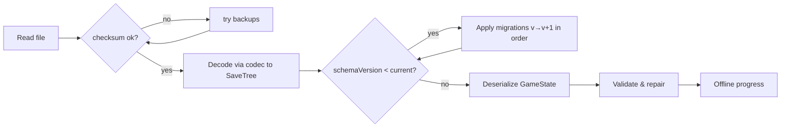

# SAVE_SYSTEM.md

> **Status:** v0.3. Approved as D-030; sections 2–4 and 7 implemented in M4 (local saves and offline). Import/export and cloud backup come in M11.

## 1. Requirements
[SPEC] Automatic saving, local saves, optional cloud backup, import/export, versioned with migrations, fully offline.

## 2. Format
- **As built (M4):** file = `"DFRS"` (4 bytes) + codec byte (`1` = gzip JSON) + data. Code: `Assets/_Game/Core/Save/` (`SaveSerializer`, `StateMapper`, `SaveStore`, `FileStores`). The payload is mapped by hand (`StateMapper`), so renaming a C# field never changes the file.
- **Codec layer (D-030):** `ISaveCodec { string Id; byte[] Encode(SaveTree); SaveTree Decode(byte[]) }`. A 4-byte magic + codec ID header precedes the payload. Development: **JSON codec**. Release (M12): add a **binary codec** (MessagePack) as the default writer; the JSON reader stays forever, so old saves load. Development builds can still export readable JSON.
- **JSON** (Newtonsoft), UTF-8, gzip-compressed on disk. Root object = `GameState` (TECHNICAL_ARCHITECTURE §5).
- Envelope:
```json
{
  "format": "DFIRPG-SAVE",
  "schemaVersion": 1,
  "gameVersion": "0.1.0",
  "savedUtcTicks": 638000000000000000,
  "savedUptimeSeconds": 5123.4,
  "playtimeSeconds": 12345,
  "checksum": "sha256-of-payload",
  "payload": { "...GameState..." }
}
```
- The payload holds the game state **and the RNG state** (inside the checksum), so a loaded game continues with the same next fight. Held offline loot (`pendingOfflineLoot`) is saved too.
- IDs are stable strings (`item.sword_rusty`). Enums are serialised as strings, never as integers, so reordering an enum never breaks saves.
- Big values (`double`) use round-trip formatting (`"R"`).

## 3. Writing
| Trigger | Notes |
|---|---|
| Every 30 s while playing | `save.autosave_interval_s` |
| On `OnApplicationPause(true)` and `OnApplicationQuit` | The most important trigger on Android |
| After critical commands | M4: boss kills, training boss, Collect, offline catch-up. Later: prestige, purchases, crafting/enchanting of Epic+ items, artifact purchase |
| Manual "Save now" | Dev panel in M4; settings in M11 |

Files live in `Application.persistentDataPath`: `save.dfrs`, `save.bak1..3`, `save.tmp`.

**Atomic write:** write `save.tmp` → flush → rename to `save.dfrs`. Before the rename, rotate `save.bak1..bak3`. On load, a failed checksum or parse falls back to the newest valid backup, and the player is told.

## 4. Loading & migration

- Each migration is a class `IMigration { int From; SaveTree Apply(SaveTree) }`, independent of the codec. They are pure and unit-tested against **fixture saves** kept in `Assets/Tests/SaveFixtures/vN.json` forever.
- A save from a **newer** schema than the app is refused (with a message), never downgraded. Loading stops there (no fallback to an older backup, which would silently lose progress) and **saving is switched off** for that session so the newer save is never overwritten.
- If every file is damaged, a new game starts and the player is told.
- **Fixtures (as built):** `Assets/Tests/SaveFixtures/v1.dfrs` (a level-31 Fighter with held offline loot and a Custom preset). Never edit or regenerate a fixture; a new schema adds `v2.dfrs` beside it and `SaveFixtureTests` checks both.
- **Validate & repair:** unknown definition IDs (removed content) are converted to their salvage value and logged. Negative currencies are clamped to 0 and logged as an anomaly.

## 5. Import / export
- Export = the envelope as **Base64 text** (copyable) or a `.dfsave` file through the Android share sheet.
- Import runs the same load pipeline into a staging slot, shows a summary (characters, levels, prestige count, saved date), and the player confirms. The current save is backed up first.
- The checksum detects corruption, **not cheating**. Single-player v1 doesn't fight edited saves. Edited saves are flagged (`Integrity.Modified = true`) for future online features.

## 6. Cloud backup (optional)
- `ICloudBackupProvider` (v1 target: Google Play Games Saved Games). Manual "Back up now" and "Restore" + auto upload at most once per hour.
- **Conflict rule:** never auto-overwrite. If cloud and local differ, show both summaries (playtime, prestige count, date) and let the player choose. The default highlight goes to the higher playtime.

## 7. Time & offline safety (as built, `Core/Offline/OfflineCalculator`)
- Save `savedUtcTicks` + `savedUptimeSeconds` (time since boot: Android `SystemClock.elapsedRealtime`, which keeps counting while the phone sleeps; editor/desktop `Environment.TickCount`).
- On start **and on return from the background**: `elapsed = now − savedUtc`.
  1. Negative → **0 credit** (clock rolled back); the report says so.
  2. Same boot (uptime now ≥ uptime at save) and `elapsed > uptime passed + offline_rules.clock_tolerance_s` (60 s) → elapsed = uptime passed (clock pushed forward).
  3. After a reboot the uptime cannot be compared: the wall clock is trusted, within the cap.
  4. Cap `offline.cap_hours` (12 h), then × `offline.efficiency` (50%) = game time simulated.
  5. Under `offline_rules.report_min_seconds` (2 min): credited silently and the loot collected at once; otherwise the welcome-back report (M4-1) is shown.
- The simulation (`GameSession.SimulateOffline`) plays fight by fight with the real engine, publishes no events, never equips, applies auto-salvage, and holds the remaining loot in `PendingOfflineLoot` until **Collect** (full-bag rule applies then).

## 8. Tests (see TESTING_STRATEGY §4)
Round-trip (save → load ⇒ same next fight); every fixture loads; corrupted file → backup recovery; crash between rotate and rename; newer schema refused; clock rollback → no rewards; clock jump clamped; huge absence capped; full bag on Collect. The real app-kill check runs on a device or emulator (`ANDROID_DEVICE_TEST.md`).
