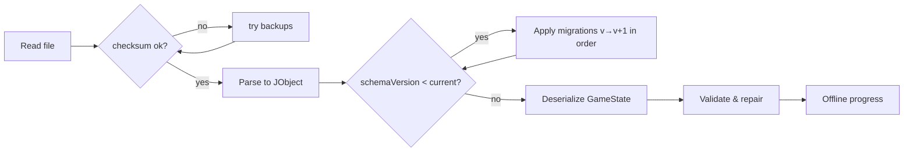

# SAVE_SYSTEM.md

> **Status:** v0.1 DRAFT.

## 1. Requirements
[SPEC] Automatic saving, local saves, optional cloud backup, import/export, versioned with migrations, fully offline.

## 2. Format
- **JSON** (Newtonsoft), UTF-8, gzip-compressed on disk. Root object = `GameState` (TECHNICAL_ARCHITECTURE §5).
- Envelope:
```json
{
  "format": "DFIRPG-SAVE",
  "schemaVersion": 1,
  "gameVersion": "0.1.0",
  "savedUtc": "2026-11-19T10:00:00Z",
  "playtimeSeconds": 12345,
  "checksum": "sha256-of-payload",
  "payload": { "...GameState..." }
}
```
- IDs are stable strings (`item.sword_rusty`). Enums are serialised as strings, never as integers, so reordering an enum never breaks saves.
- Big values (`double`) use round-trip formatting (`"R"`).

## 3. Writing
| Trigger | Notes |
|---|---|
| Every 30 s while playing | Debounced |
| On `OnApplicationPause(true)` / focus loss | The most important trigger on Android |
| After critical commands | Prestige, purchases, crafting/enchanting of Epic+ items, artifact purchase |
| Manual "Save now" in settings | — |

**Atomic write:** write `save.tmp` → flush → rename to `save.json.gz`. Before the rename, rotate `save.bak1..bak3`. On load, a failed checksum or parse falls back to the newest valid backup, and the player is told.

## 4. Loading & migration

- Each migration is a class `IMigration { int From; JObject Apply(JObject) }`. They are pure and unit-tested against **fixture saves** kept in `Assets/Tests/SaveFixtures/vN.json` forever.
- A save from a **newer** schema than the app is refused (with a message), never downgraded.
- **Validate & repair:** unknown definition IDs (removed content) are converted to their salvage value and logged. Negative currencies are clamped to 0 and logged as an anomaly.

## 5. Import / export
- Export = the envelope as **Base64 text** (copyable) or a `.dfsave` file through the Android share sheet.
- Import runs the same load pipeline into a staging slot, shows a summary (characters, levels, prestige count, saved date), and the player confirms. The current save is backed up first.
- The checksum detects corruption, **not cheating**. Single-player v1 doesn't fight edited saves. Edited saves are flagged (`Integrity.Modified = true`) for future online features.

## 6. Cloud backup (optional)
- `ICloudBackupProvider` (v1 target: Google Play Games Saved Games). Manual "Back up now" and "Restore" + auto upload at most once per hour.
- **Conflict rule:** never auto-overwrite. If cloud and local differ, show both summaries (playtime, prestige count, date) and let the player choose. The default highlight goes to the higher playtime.

## 7. Time & offline safety
- Save `LastSavedUtc` + `LastElapsedRealtime` (monotonic since boot).
- On load: `elapsed = now − LastSavedUtc`. If negative → 0 credit (clock rolled back) and an anomaly is logged. Then the offline cap is applied.

## 8. Tests (see TESTING_STRATEGY §4)
Round-trip (save → load ⇒ deep equality); every fixture migrates to current; corrupted file → backup recovery; kill during write simulation; clock rollback → no rewards.
