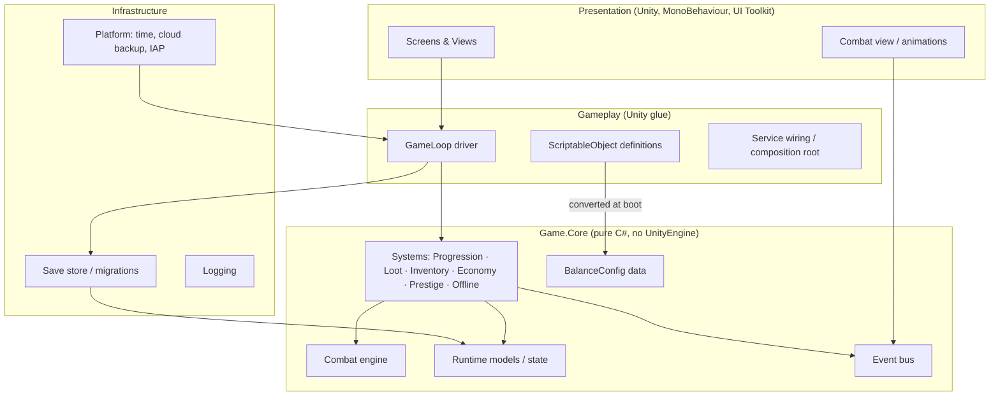
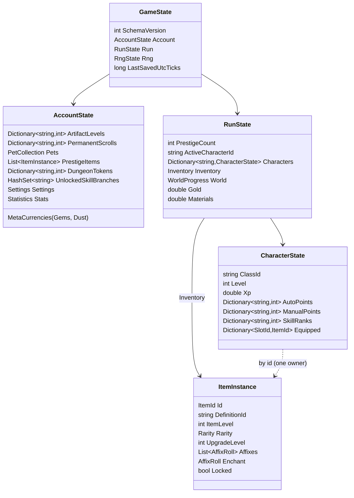

# TECHNICAL_ARCHITECTURE.md

> **Status:** v0.2. Technology choices approved on 2026-11-19 (D-010…D-013, D-030…D-032).

## 1. Technology choices

| Area | Recommendation | Alternatives considered | Why |
|---|---|---|---|
| Engine | **Unity 6 LTS** (newest LTS in Unity Hub) | 2022 LTS | Long support window, current Android tooling |
| Render pipeline | **URP with 2D Renderer** | Built-in | Supported going forward, 2D lights for dark-fantasy mood, sprite batching on mobile. Built-in is in maintenance |
| UI | **UI Toolkit** for all menus and management screens; sprites + uGUI only for the combat view overlays (damage numbers, HP bars) | uGUI only | The game is ~80% data-heavy screens (inventory, trees, stats). UI Toolkit's flex layout, USS styling and list virtualisation (`ListView`) suit that. Its weak spot (world-space effects) is limited to the combat strip |
| Serialisation | **Swappable codec (D-030):** Newtonsoft JSON during development, binary (MessagePack) added at release | — | Migrations run on a format-neutral tree; the header names the codec; both are readable forever |
| Async/content | Addressables (from M5, for region art) | Resources | Region art grows into hundreds of zones |
| Testing | Unity Test Framework (EditMode + PlayMode) + `dotnet test` for Game.Core | — | Core runs headless in CI and cloud sessions |
| Animation | 2D skeletal (`com.unity.2d.animation`) for heroes, sprite-swap for enemies | Spine | Free, modular parts, palette swaps |
| CI | GitHub Actions: `dotnet test` on every push (M1). GameCI Unity tests + Android build later (M4) | — | Unity licence needed for GameCI |
| Big numbers | `double` + custom formatter | BreakInfinity | Enough to about region 700 (risk T-03) |
| Balance tooling (D-031) | Python simulation + Google Sheets view + C# simulation runner (`Tools/BalanceSim.CSharp`, console app on Game.Core) | — | One authority: `balance_config.json` |

## 2. Layered architecture



**Rules**
1. **Game.Core references nothing from Unity** (`noEngineReferences: true` in its asmdef). It compiles with plain .NET (netstandard2.1), so the logic can be tested in CI and in cloud sessions without the editor.
2. Presentation only reads state and listens to events. It changes state only through **commands** (`EquipItemCommand`, `PrestigeCommand`…) handled by systems. This gives a single place to validate, log and test player actions.
3. **Extensibility (D-032):** attributes, class templates, item types per slot, affixes, enchants, skills and pet effects are definitions. Combat effects are composed from reusable effect blocks (`EffectSpec`), so new variations need no code.
4. Definitions (ScriptableObjects) are authored in the editor and converted at boot into immutable Core definition records. Core never touches a ScriptableObject.
5. No singletons except the composition root. Systems receive dependencies through their constructor.

## 3. Assemblies

| Assembly | References | Contents |
|---|---|---|
| `Game.Core` | — | Models, systems, combat, RNG, formulas, events, commands, save DTOs, migrations |
| `Game.Core.Tests` | Core | NUnit tests (run in Unity and `dotnet test`) |
| `Game.Data` | Core, UnityEngine | ScriptableObject definitions + converters + validation |
| `Game.Infrastructure` | Core, UnityEngine | File save store, logging sink, platform time, cloud backup adapters |
| `Game.Presentation` | Core, Data, Infrastructure, UnityEngine.UIElements | Composition root, game loop, screens, combat view |
| `Game.Editor` | Data | Content validators, balance import from JSON, debug windows |
| `Game.PlayMode.Tests` | all | Smoke and integration tests |

## 4. Folder structure

```
dark-fantasy-idle-rpg/
├─ Assets/
│  ├─ _Game/
│  │  ├─ Core/               Game.Core.asmdef   (pure C#)
│  │  │  ├─ Combat/  Characters/  Items/  Loot/  Economy/
│  │  │  ├─ Progression/  Prestige/  Offline/  Pets/  Dungeons/  Skills/
│  │  │  ├─ Random/  Events/  Commands/  Config/  Save/  Util/
│  │  ├─ Data/               Game.Data.asmdef
│  │  │  ├─ Definitions/ (SO classes)   Content/ (SO assets: regions, items, pets…)
│  │  ├─ Infrastructure/     Game.Infrastructure.asmdef
│  │  ├─ Presentation/       Game.Presentation.asmdef
│  │  │  ├─ Boot/  Screens/  Combat/  Widgets/  UI/ (UXML, USS)
│  │  ├─ Art/  Audio/  Fonts/
│  │  └─ Scenes/  Boot.unity, Main.unity
│  ├─ Tests/  EditMode/ PlayMode/
├─ Docs/                     the 8 project documents
├─ Tools/BalanceSim/         Python reference simulation + Sheets exporter
├─ Tools/BalanceSim.CSharp/  C# simulation runner (links Game.Core)
├─ Core.Tests.Dotnet/        .csproj that compiles Assets/_Game/Core and Assets/Tests/EditMode/Core for `dotnet test`
├─ .github/workflows/        CI (core tests, golden freshness, simulation smoke runs)
├─ Packages/  ProjectSettings/
```

## 5. Core data model



**Prestige = replace `RunState` with a fresh one.** `AccountState` is untouched. Because the split is structural, the reset rules are enforced by the shape of the data, not by a list of fields to clear (QA risk reduced).

Items are referenced by `ItemId` from `Equipped`. The **Inventory** enforces the one-owner rule (D-004) by keeping an `ownerByItem` index.

## 6. Combat engine

- `CombatEngine.Resolve(CombatantSnapshot player, CombatantSnapshot enemy, IRng rng, ICombatListener? listener) → FightResult`.
- Event queue: a min-heap of `(time, actor, action)`. Actions: BasicAttack, Skill(id), DoT tick, Enrage.
- `CombatantSnapshot` is computed by `StatCalculator` from the character, gear, pets, skills, artifacts and scrolls, and cached until a `StatsDirty` event.
- **Online:** `GameLoop` advances game time by `Time.deltaTime × speed` and the engine emits events whose time is ≤ now. The view plays them (or skips them when animations are off).
- **Offline:** `OfflineSimulator` calls the same engine without a listener, looping fights until the credited time is used up. Budget: 6 h credited at 2 s/fight ≈ 10 800 fights × ~20 events ≈ 200 k operations, about 50 ms on mid-range Android. A guard drops to analytic batching if the expected count exceeds 200 k fights.
- **Determinism:** `IRng` = PCG32 with explicit state stored in the save. Never `UnityEngine.Random` or `System.Random`. No float maths in reward-affecting paths; use `double` with fixed operation order.

## 7. Systems (Core)

| System | Responsibility |
|---|---|
| `StatCalculator` | Derive final stats from all sources (pure function) |
| `ProgressionSystem` | XP, levels, attribute points |
| `WorldSystem` | Subzone/boss state, kill counts, boss toggle, retreat rules |
| `LootSystem` | Loot tables, rarity rolls, affix rolls, item creation |
| `InventorySystem` | Ownership, equip/unequip, capacity, lock, auto-salvage filter |
| `CraftingSystem` / `EnchantingSystem` / `UpgradeSystem` | Item improvement transactions |
| `EconomySystem` | Wallets with validated spends (no negative balances, all spends logged) |
| `PetSystem`, `DungeonSystem`, `SkillSystem` | Their domains |
| `PrestigeSystem` | Dust calculation, run reset, artifact purchases |
| `OfflineSystem` | Elapsed-time validation, capped simulation, report |
| `AchievementSystem` | Listens to events, grants gems |

## 8. Events & commands
- `IEventBus` with typed `Publish<T>` / `Subscribe<T>`, synchronous, in Core. Examples: `EnemyKilled`, `ItemDropped`, `LevelUp`, `BossDefeated`, `PrestigeCompleted`, `StatsDirty`.
- Commands are plain records. `CommandDispatcher` validates, executes, then publishes events and logs. Commands are also the future **online seam**: a server could validate the same commands (§11).

## 9. Configuration
- `BalanceConfig` (Core record) mirrors `Tools/BalanceSim/balance_config.json`. An editor tool imports the JSON into `BalanceConfigAsset`, so the Python simulation and the game read **the same numbers**.
- Content definitions: `RegionDefinition`, `SubzoneDefinition`, `EnemyDefinition`, `FamilyDefinition`, `ItemDefinition`, `AffixDefinition`, `LootTable`, `PetDefinition`, `SkillDefinition`, `ArtifactDefinition`, `DungeonDefinition`, `AttributeDefinition`, `ElementDefinition`. All keyed by **stable string IDs**, never by asset references, in saves.
- An editor validator runs on build: missing IDs, loot tables that don't sum correctly, unreachable regions.

## 10. Logging
`ILog` in Core (Debug / Info / Warn / Error + category). The Unity sink writes to the console in the editor and to a rotating file (`persistentDataPath/logs`, 3 × 1 MB) on device. Save, prestige and purchase actions always log at Info.

## 11. Future online seams (interfaces only, no implementation)
`ICloudBackupProvider`, `ILeaderboardService`, `IEventCalendar`, `ITradeService`, `IIdentityService`. The composition root binds them to `Null…` implementations in v1. A future trade design (restricted, anti-RMT) would build on item instances' immutable `Id` + `Origin` (`Drop` / `Craft` / `Trade`) and a `Tradeable` flag already in the item model.

## 12. Android build pipeline
- IL2CPP, ARM64 (+ ARMv7 optional), target API = current Play requirement, minimum API 26 (proposal), AAB output, Play App Signing.
- Frame budget: 30 FPS default and 60 optional. A **battery mode** disables combat animations and caps at 15 FPS (combat logic is unaffected).
- Build profiles: `Dev` (logs, cheat panel) and `Release` (stripped).

## 13. Technical risks

| ID | Risk | Mitigation |
|---|---|---|
| T-01 | Offline sim too slow for long gaps on low-end phones | Budget guard + analytic batching; perf test on device in M4 |
| T-02 | Save corruption (app killed during write) | Atomic write, rolling backups (SAVE_SYSTEM.md) |
| T-03 | `double` overflow past ~region 700 | Formatter + range tests; swap to a big-number struct behind a `Num` alias if ever needed |
| T-04 | Clock manipulation for offline gains | Monotonic checks, cap, clamp backward jumps; server time when online later |
| T-05 | Unity tooling can't run in cloud sessions | Keep Core pure C#, testable with `dotnet` |
| T-06 | UI Toolkit runtime gaps (e.g. complex animations) | Limited to menus; combat uses sprites |
| T-07 | Scope creep for one developer | Milestones with acceptance gates (ROADMAP) |
